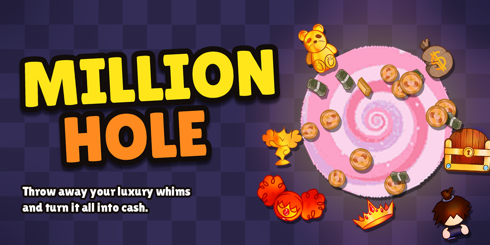
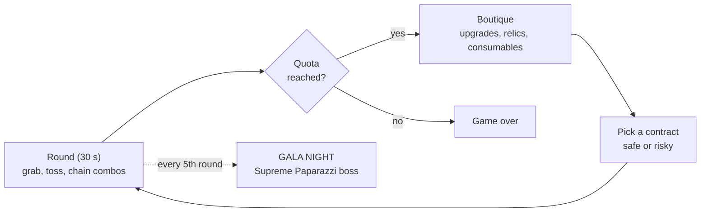

### Throw away your luxury whims and turn it all into cash.

---

## About

**Million Hole** is a fast top-down arcade roguelike. You are a spoiled heiress with way too much stuff: grab luxury items, toss them into the vortex, and watch them turn into coins, bills and gold bars. Reach the quota before the 30-second clock runs out… while the paparazzi hunt you down.

Made for the **Revival Game Jam**, whose theme is bringing something old back to life. The game is inspired by *Princesa Más Billetes* (“Princess Plus Bills”).

👉 **[Visit the presentation page](https://felipebeltraning.github.io/ProyectoGameJam-1_/)** · 🎮 **[Play it on itch.io](https://felipebeltran.itch.io/million-hole)**

## How it plays

1. **Grab** luxury items and **toss** them into the vortex.
2. **Chain your drops** to build a combo (up to x3) and earn more points.
3. **Fulfil Today’s Whims** (the heiress’s wish list) for bonus points and extra seconds.
4. **Reach the score quota** before time runs out, or the run is over.
5. **Spend your cash** at the boutique, then pick a contract: play it safe or gamble for more money.

## Controls

| Key | Action |
|---|---|
| `WASD` / Arrow keys | Move |
| `E` / `Space` | Pick up items, or drop them inside the vortex |
| `Q` | Bag Smack: stuns nearby paparazzi (boutique upgrade) |
| `Shift` | Luxury Turbo: +70% speed for 3 s (consumable) |
| `F` | Blinding Flash: stuns ALL paparazzi (consumable) |
| Automatic | Diamond Shield blocks the next hit (consumable) |

## Features

- **12 luxury items**, from pearl necklaces to a golden statue
- **Rotating boutique** with 11 upgrades, 3 consumables and 8 relics (every relic has a downside!)
- **6 risk contracts**, from the safe *Calm Round* to the brutal *Double or Nothing*
- **Hazards:** champagne puddles, pop-up spikes and a vortex that never stays put
- **A Gala boss every 5 rounds:** the Supreme Paparazzi, who only whims can hurt
- No save files: close the game and the fortune is gone

## Run it from source

1. Install [Godot 4.6](https://godotengine.org/download) (the project was made with this version).
2. Clone this repository.
3. Open Godot, click **Import**, and select the `project.godot` file inside the `game/` folder.
4. Press **F5** to play.

To make the web version: **Project → Export → Web**, then zip the exported files (with `index.html` at the root of the zip) and upload it to itch.io as an HTML5 game.

## Repository layout

| Path | What it is |
|---|---|
| `game/` | The Godot project (scripts, scenes, sprites and audio) |
| `index.html` | The presentation page published with GitHub Pages |
| `banner.png` | The image at the top of this README |

## Credits

- **Programming and game design:** [FelipeBeltranING](https://github.com/FelipeBeltranING)
- **Art and audio:** *add the names of your artists and the sources of every sound and music track here*
- **Font:** [Lilita One](https://fonts.google.com/specimen/Lilita+One) (SIL Open Font License)
- **Engine:** [Godot](https://godotengine.org/)
- **Inspiration:** *Princesa Más Billetes*
